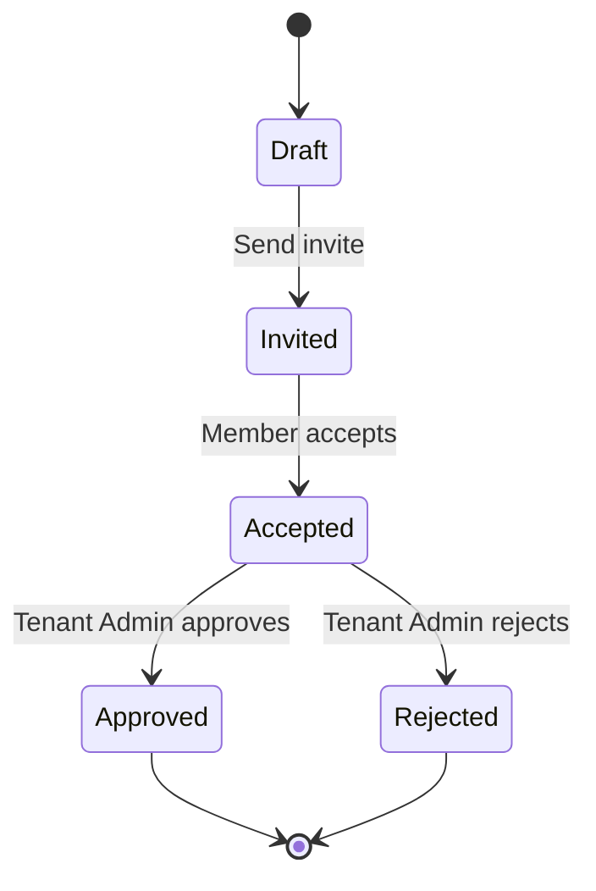

# Technical Assessment: Guided Pass-Member Onboarding Flow

## How To Approach This Assigment

- We will provide each of you a guest account on Slack. Use it to communicate with us and ask questions - we are here to help.
- Regardless of whether you chose an in-person work trial or a take home, the assignment is due by 5pm on Friday, Feb 27.
- We want you to be creative - this assignment isn't to slap a chatbot in a dashboard. Think about user experience and how AI can best be leveraged to make the process frictionless and easy, while also supporting traditional forms and data entry in a sophisticated and easy to use way. This is your chance to create a truly novel way of approaching this broad and challenging data onboarding challenge that can directly impact the speed of rollouts and value of our company.

---

## Overview

One of the biggest pain points in our onboarding process today is getting all pass members set up before a facility goes live. If members aren't onboarded ahead of time, they hit issues at the gate on day one.

Your task is to build a **guided onboarding flow** that enables a Vend Admin and a Tenant Admin to collaboratively onboard all pass members for a parking facility before go-live. The system must support three invite methods (email, phone, access code/QR), track progress toward full onboarding, and use AI to assist with bulk data import from varied document formats.

---

## Domain Context

Here is a quick primer on the domain:

- **Vend Admin** -- Internal operator who kicks off the onboarding by inviting the Tenant Admin.
- **Tenant Admin** -- The tenant's point-of-contact who manages their own company's pass member onboarding.
- **Tenant** -- A company or organization that leases parking for its employees.
- **Pass** -- A named parking pass type belonging to a Tenant (e.g., "Executive Reserved", "General Employee").
- **Pass Member** -- An individual person who will receive a specific pass. They must be invited, accept the invite, and be approved.

### Invite Lifecycle



---

## Functional Requirements

### Part 1: Vend Admin -- Tenant Setup

1. **Tenant invite form** -- Vend Admin enters tenant company name, admin contact name, email, and phone. Submitting creates a Tenant record and sends a mock invite (no real email).
2. **Tenant list** -- Vend Admin sees all tenants with onboarding status (Not Started, In Progress, Complete).

### Part 2: Tenant Admin -- Onboarding Wizard

A multi-step guided flow:

**Step 1: Define Passes**

- Tenant Admin creates one or more pass types (name, description).
- For each pass, the Tenant Admin sets a **target member count** -- how many people they expect to onboard for that pass initially. This is used to track onboarding progress (note: more members may be added after go-live as the company grows, but the target count represents the initial onboarding goal).

**Step 2: Add Members (per pass)**

- The Tenant Admin selects a pass type first, then chooses an "Add Members" action for that pass.
- Three input methods, all producing the same normalized member list scoped to the selected pass:
  - **Manual entry** -- Form to add members one at a time (name, email and/or phone).
  - **File upload** -- Upload a CSV or Excel file. A downloadable Vend template is provided so the Tenant Admin can fill in member data in the expected format. The system parses and previews extracted rows.
  - **AI document import** -- Upload an unstructured document (lease PDF, security system export, free-form text). An AI model extracts names + contact info and presents them for review/correction.
- De-duplication: flag likely duplicates across imports.

**Step 3: Send Invites**

- The system automatically determines the invite method for each member based on available contact data, using this priority order:
  1. **Email** -- if an email address is present, send an email invite (mocked).
  2. **Phone/SMS** -- if no email but a phone number is present, send an SMS invite (mocked).
  3. **Access Code / QR** -- if neither email nor phone is available, generate a unique access code and QR that the Tenant Admin can distribute physically.
- The Tenant Admin should be able to send invites in bulk or individually.
- The Tenant Admin should be able to override the auto-selected method if needed.
- The system should track which invites have been sent and maintain an audit trail of every send attempt (including resends), capturing the method used and timestamp.

**Step 4: Monitor & Approve**

- Accept/Reject controls for each member who has accepted their invite (guards against wrong-person or rogue QR scans).
- Ability to resend or change invite method for pending members.

### Part 3: Vend Admin -- Configure Billing

After the Tenant Admin has defined their passes, the Vend Admin configures the billing structure for each pass. The billing type options are:

- **Recurring** -- A recurring subscription fee (e.g., monthly or annual).
- **Usage-based** -- Charged based on actual usage (e.g., per seat).

This step does not require real payment processing -- just model the billing type selection on each pass and display it in the UI.

### Part 4: Onboarding Dashboard

Both the Vend Admin and Tenant Admin need dashboards to track onboarding progress. **You are expected to design and define the dashboard contents yourself.** Think about what each role would need to see to effectively manage the onboarding process and ensure readiness before go-live.

Some questions to guide your thinking:

- What does a Vend Admin need to see across all tenants in a garage?
- What does a Tenant Admin need to see for their own company's onboarding?
- How should progress be visualized so that blockers and at-risk items are immediately obvious?
- What actions should be available directly from the dashboard?

### Part 5: AI-Assisted Features

You must integrate at least one meaningful AI feature using the **Vercel AI SDK**:

- **Document parsing** (required) -- Given an uploaded file (PDF, CSV, Excel, or pasted text), use an LLM to extract structured member data (name, email, phone, role/pass assignment). Present results in a review table where the admin can correct mistakes before confirming. Keep in mind that onboarding data may come from many formats: tenant lease documents, Excel spreadsheets, security system CSV exports, free-form text, etc.
- **Smart column mapping** (encouraged) -- For CSV/Excel uploads, AI suggests which columns map to which fields.
- **Onboarding assistant** (bonus) -- A chat-based helper that can answer questions like "How many members still need to accept for the Executive pass?" or "Who hasn't been invited yet?"

---

## Technical Requirements

### Scaffold

Use **Better-T-Stack** with the prescribed configuration:

```bash
npx create-better-t-stack@latest onboarding-flow \
  --backend convex --runtime none --api none --database none --orm none --auth none \
  --addons biome,ruler,turborepo,ultracite
```

You may add additional options if helpful. Do **not** remove any of the above.

### Stack

- **Frontend:** React + Vite (scaffolded by Better-T-Stack with TanStack Router)
- **Backend:** Convex (real-time reactive database + serverless functions)
- **Styling:** Tailwind CSS v4 + shadcn/ui
- **Validation:** Zod schemas for all data boundaries
- **Rendering:** Static site generation only (no SSR)
- **Auth:** Mocked -- use a simple role switcher or seed two fake users (Vend Admin / Tenant Admin). Do not implement real authentication.
- **Storybook:** Required for shared UI components (at minimum: progress indicators, invite status badges, member table row)
- **TypeScript:** Strict mode, no `any`, shared types between frontend and Convex functions. Strong type safety throughout.

### Optional Tooling (encouraged where appropriate)

- **React Flow** -- for visualizing the onboarding pipeline or pass/member relationships
- **Vercel AI SDK** -- for the AI document import feature
- **Zod + Convex validators** -- for end-to-end type-safe mutations/queries

---

## Evaluation Criteria

Here is how we will evaluate your submission:

### Architecture and Design (25%)

- Clean separation between Convex backend logic and React UI
- Thoughtful data modeling (relationships, indices, status transitions)
- Multi-step wizard state management approach
- Role-based view scoping (Vend Admin vs. Tenant Admin)

### TypeScript and Type Safety (20%)

- Strict TypeScript throughout (no `any`, proper generics)
- Shared types/validators between frontend and Convex
- Zod schemas at data boundaries (file parsing, form inputs)

### AI Integration (20%)

- Quality of the document-parsing feature (handles messy inputs gracefully)
- User experience of the review/correction flow after AI extraction
- Prompt engineering quality and error handling

### UI/UX Quality (20%)

- Polished, intuitive onboarding wizard
- Clear progress visualization
- Good use of shadcn components and Tailwind
- Storybook stories for key components

### Code Quality and Practices (15%)

- Consistent code style (Biome enforced)
- Meaningful component decomposition
- Error handling and edge cases
- README with setup instructions and architectural decisions

---

## Deliverables

1. **GitHub repository** with the complete project.
2. **README.md** covering:
   - How to run the project locally
   - Your architectural decisions and trade-offs
   - What AI features you implemented and how they work
   - What you would improve given more time
3. **Storybook** running with stories for shared components.
4. **Short video or Loom** (3-5 min) walking through the onboarding flow end-to-end.